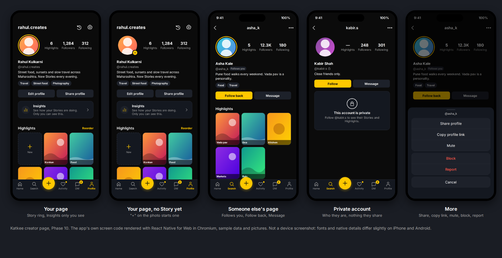

# Phase 10: the creator page

Date: 12 October 2026. Branch `claude/katkee-production-audit-kuexra`.
Labels follow `docs/BASELINE_REPORT_2026-10-05.md`.

**Production-ready: no.** The pages are tested in app component tests and checked visually in a
browser render, not on a device (the Android build is blocked by the network policy, and there
is no Mac for iOS).

You asked for a creator page as professional as Instagram's and Snapchat's. Katkee's own rules
stay:
- Stories open only from the profile photo; there is no grid of posts.
- Highlights are permanent portrait cards, three per row.
- Insights and viewer identities are only for the owner.

*The app's own screen code rendered with React Native for Web in Chromium, with sample data
(`tools/screen-preview`). Not a device screenshot: fonts and native details differ slightly.*

## What changed

| Part | Before | Now |
|---|---|---|
| Header | Centred photo, name, then two counts | The photo on the left in its Story ring, with three counts beside it (Highlights, Followers, Following). Counts read like a profile's: exact below 10,000, then 12.3K, 123K and 1.2M, rounded down. Screen readers hear the exact number |
| Identity | Name, @username, bio, chips | Name, @username with a lock when private, a "Follows you" tag, the bio, and interest chips |
| Your page | Settings in a corner; Edit and Share; Archive and Insights as small links | A top bar with your username, Archive and Settings. Edit profile and Share profile side by side. An Insights card that says only you can see it. A "+" on your photo starts a Story when you have none. Pull down to refresh |
| Someone's page | Follow and Message; "Report this account" as small grey text | Follow, Follow back (when they follow you), Following or Requested, and Message. Unfollowing and cancelling a request ask first. The username and a More button sit in the header. More holds Share profile, Copy profile link, Mute/Unmute, Block (asks first, then leaves the page) and Report. Pull down to refresh |
| Private accounts you don't follow | Their Highlights row silently empty | A clear "This account is private" card. Highlights show as unknown, not zero, and the follower lists can't be opened |
| No Highlights | Nothing | "No Highlights yet" on other people's pages; the New card on yours |
| Loading and errors | A spinner; an error with no way back | The page's shape while it loads; Try again when it fails |
| Highlights | Portrait cards, 3 per row, Reorder | Unchanged cards under a "Highlights" title with Reorder beside it. The grid now reports its count to the header and reloads on pull to refresh |

All existing routes still work: Story viewer, Followers and Following, Edit Profile, Archive,
Insights, Settings, Highlight editor and viewer, Report and DM.

## Outcome by requirement

| Requirement | Status | Evidence |
|---|---|---|
| Professional creator page (your own and others') | IMPLEMENTED AND VERIFIED (component tests, browser render) / NOT VERIFIED (device) | `profile.test.tsx` (10); screenshots above |
| Stories only through the photo; no post grid | Kept | The ring opens the Story viewer; tests "an active Story rings the photo and opens from it" and "with one, the ring opens it" |
| Highlights portrait, 3 per row | Kept | `highlights.test.tsx` unchanged and passing, plus a count/refresh test |
| Insights owner-only | Kept | The Insights card exists only on your own page |
| Privacy of private accounts | IMPLEMENTED AND VERIFIED (app) | The private card; Highlights unknown; lists closed. The server already refuses those lists (403) |
| Share links survive renames | Kept | Share and Copy link use `katkee://user/<name>?id=<id>` (test checks the exact link) |

## Bug found by rendering the page

**The Like heart was a malformed drawing.** Its last curve had 4 numbers instead of 6. A
browser draws such a path only up to the error, so the heart's lower right was missing. The
same heart is the Activity tab icon. It now ends with the mirror of its left side, so it is
symmetric.

A new source check, `verification/icon-paths.cjs`, makes sure every path in the icon family is
well-formed. It fails on the old heart and passes on the fixed one, and it now runs in
`scripts/verify.cjs`.

## Deliberate breaks: each check must fail on a real defect

- **App: 18 of 18 caught**, after one test addition (`mutations.json` in the Phase 12 evidence
  folder). The breaks:
  - unfollowing without asking;
  - private pages showing everything, and their lists opening;
  - "Follows you" hidden; "Follow back" missing;
  - Block staying on the page;
  - no Try again; no "No Highlights yet";
  - the share link without the account ID;
  - a More action running while the sheet is still closing (iOS can't show an alert then);
  - Mute not changing to Unmute;
  - screen readers hearing the rounded count;
  - "+" shown beside an active Story; the ring not opening the Story;
  - counts rounded up.
- The first run missed "the Highlights grid never reports its count" (the page tests use a
  stand-in grid). `highlights.test.tsx` now checks the count, "unknown" for a refused list, and
  reloading on refresh; those three breaks (two of them new) are caught.

## Test changes

- New: `profile.test.tsx` (10 tests); one test in `highlights.test.tsx`; the
  `icon-paths.cjs` source check (2 tests).
- `search.test.tsx`: its stand-in navigation gained `setOptions`, which the page now uses to
  put the username and More in the header. No assertion changed.

## Commands and results

| Command | Result |
|---|---|
| App typecheck and test typecheck | passed |
| `npx jest` (app component tests) | 13 suites, 62 tests, all passed |
| Source checks (`scripts/verify.cjs` list) | all passed, including the new icon-path check |
| Browser render (`tools/screen-preview`, `npm run shots`) | 5 screens, no runtime errors |

The full gate (verification script, release bundles and the database suite) runs once more at
the end of Phase 12.

## Next

- **Phase 11**: the rest of Edit Profile (photo take, crop and preview; Save and Discard; every
  screen updating after a change).
- **Phase 12**: final verification, the iOS and App Store guide, and the release ZIP.
