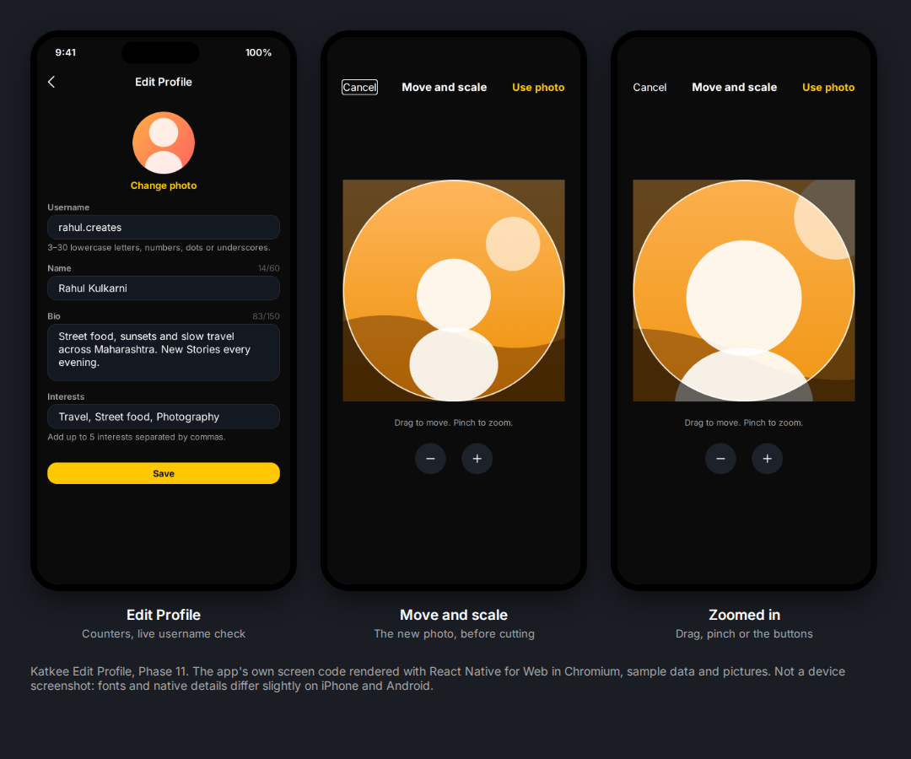

# Phase 11: Edit Profile, finished

Date: 12 October 2026. Branch `claude/katkee-production-audit-kuexra`.
Labels follow `docs/BASELINE_REPORT_2026-10-05.md`.

**Production-ready: no.** Everything here is tested in app component tests and checked visually
in a browser render. The camera, the photo picker and the on-phone crop have not run on a device
(the Android build is blocked by the network policy, and there is no Mac for iOS).

This finishes spec section 23 after Phase 8's username work:
- photo take, crop and preview, with the old photo kept until Save succeeds;
- Save and Discard with a confirmation;
- every screen showing the change.

*The app's own screen code rendered with React Native for Web in Chromium, with sample data
(`tools/screen-preview`). Not a device screenshot.*

## What changed

| Part | Before | Now |
|---|---|---|
| Photo | Choose from the library only, uploaded as picked (shown centre-cropped) | A sheet: Take photo (front camera), Choose from library, Remove current photo (only when there is one). Then **Move and scale**: drag to move, pinch or the zoom buttons to zoom (1x to 4x), inside a circle |
| What is uploaded | The whole picked photo | Only the square you chose, cut on the phone (Nitro Image), at most 640 x 640 JPEG. The rest of the photo never leaves the phone |
| When it changes | On Save | On Save, as before. The old photo stays until Save succeeds, and the screen says "Your new photo is used when you save" |
| Removing your photo | Not possible | Remove current photo, then Save, sends `avatarMediaId: null` (the server already supported it) |
| Camera permission | Not used | Android asks for the camera first. A refusal, there or on iOS, offers your phone's Settings, and nothing opens |
| Name and bio | Bio counter only | Counters for both (60 and 150). An empty name shows "Enter your name." and Save stays off. The bio is saved trimmed |
| Unsaved changes | Lost silently on back | Back, Android back and the iOS swipe ask "Discard changes?" (Keep editing / Discard). Save with nothing changed just closes. A failed save keeps your changes and stays |
| Other screens | Your page updated; Home kept your old name and photo on your own Story until it reloaded | Your page updates at once (as before), and Home reloads after a save |

## Outcome by requirement (spec 23)

| Requirement | Status | Evidence |
|---|---|---|
| Avatar capture, crop and preview | IMPLEMENTED AND VERIFIED (component tests, browser render) / NOT VERIFIED (device camera, picker and crop) | `editProfile.test.tsx`: the cut square is exactly what the model computes, then resized to 640; only the cut file is uploaded; the cropper's math has its own tests |
| Old avatar kept until the save commits | IMPLEMENTED AND VERIFIED | Nothing is uploaded before Save (tested) |
| Save and Discard with confirmation | IMPLEMENTED AND VERIFIED (component tests) | `usePreventRemove`: the guard turns on with a change and off before leaving after a save; Discard leaves, Keep editing stays |
| Name and bio rules | IMPLEMENTED AND VERIFIED | Counters, an empty name blocks Save. The server limits (name 60, bio 150, interests 5) are unchanged and still checked there |
| Every cached surface updates | IMPLEMENTED AND VERIFIED (component tests) | Your page reads your account, which the save updates. Home reloads on the new "profile changed" signal (`home.test.tsx`). Other lists (search, DMs, comments) fetch fresh data when opened; photos are addressed by their media ID, so a new photo is always a new address |

### Decision to confirm

**The crop happens on the phone**, not the server, so only the square you chose is ever
uploaded. A server-side crop would keep the full photo on the server, and its larger copy could
still be fetched. Older app versions still upload whole photos, and the server shows them
centre-cropped, as before.

## Deliberate breaks: each check must fail on a real defect

**App: 19 of 19 caught**, after one test addition (`mutations.json` in the Phase 12 evidence
folder). The breaks:
- **The cut:** the original uploaded instead of the cut; no resize; a non-square cut; dragging
  moving the wrong way; zoom unbounded; the square leaving the photo.
- **Save and Discard:**
  - no guard, or the guard still on after saving;
  - Discard doing nothing;
  - a failed save leaving the screen;
  - Save with nothing changed still sending.
- **The photo itself:**
  - removal not sent, or the photo field sent when unchanged;
  - the camera opened without permission;
  - "Remove" offered with no photo.
- **Name, and other screens:** an empty name allowed; other screens not told; Home ignoring the
  signal.

The first run missed "a screen that stopped listening is still called" (Home is gone by then,
so nothing visible happens). A direct test of unsubscribing catches it now.

## Test and check changes

- New: `editProfile.test.tsx` (13 tests: cut math, photo flow, Save and Discard, name and bio)
  and `home.test.tsx` (2).
- `__tests__/setup.js` gained a stand-in for Nitro Image, which records each crop step, as it has
  for the camera and photo picker. Its camera picker can now return a photo.
- `username.test.tsx`: Edit Profile now uses `usePreventRemove`, which needs a navigator. That
  file renders the screen alone, so it replaces the hook. No assertion changed.
- `verification/native-permissions.cjs` now also treats `launchCamera` as camera use.
- iOS wording: the camera and photo library explanations mention the profile photo.
- The creator page's More sheet now uses the shared `ActionSheet` (no behaviour change; its 10
  tests pass unchanged).

## Commands and results

| Command | Result |
|---|---|
| App typecheck and test typecheck | passed |
| `npx jest` (app component tests) | 15 suites, 77 tests, all passed |
| Source checks (`scripts/verify.cjs` list) | all passed |
| Browser render (`tools/screen-preview`) | Edit Profile and the cropper, no runtime errors |

The full gate runs once more at the end of Phase 12.
