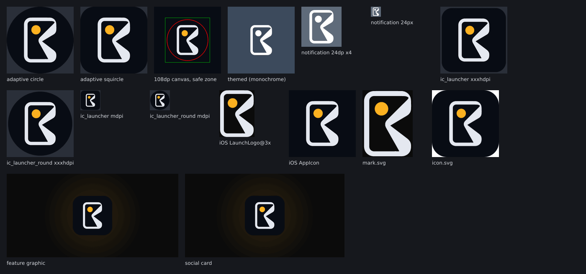
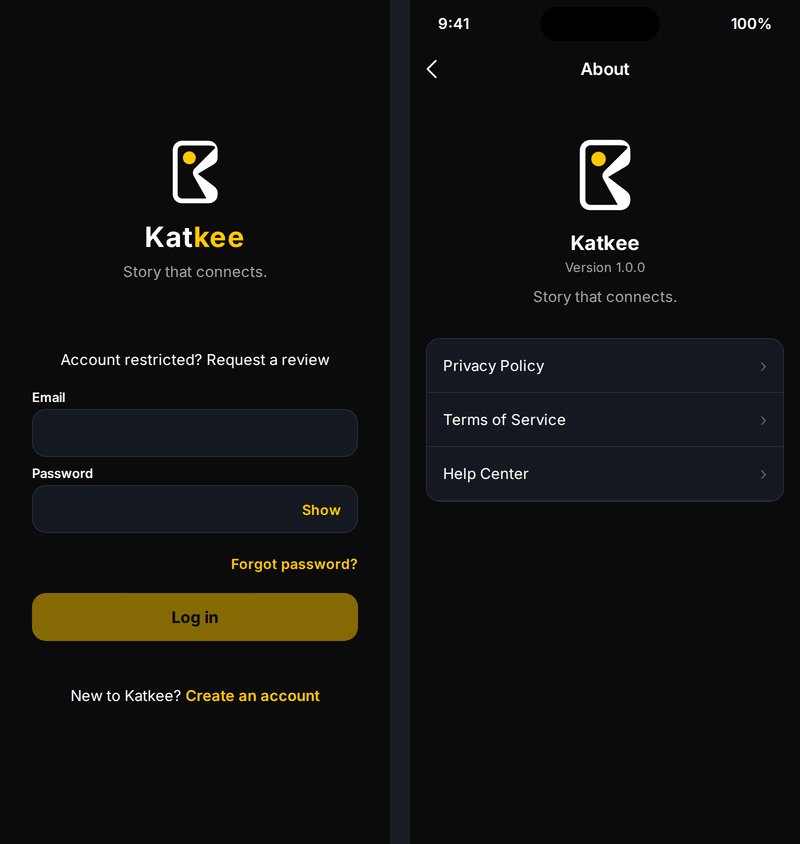
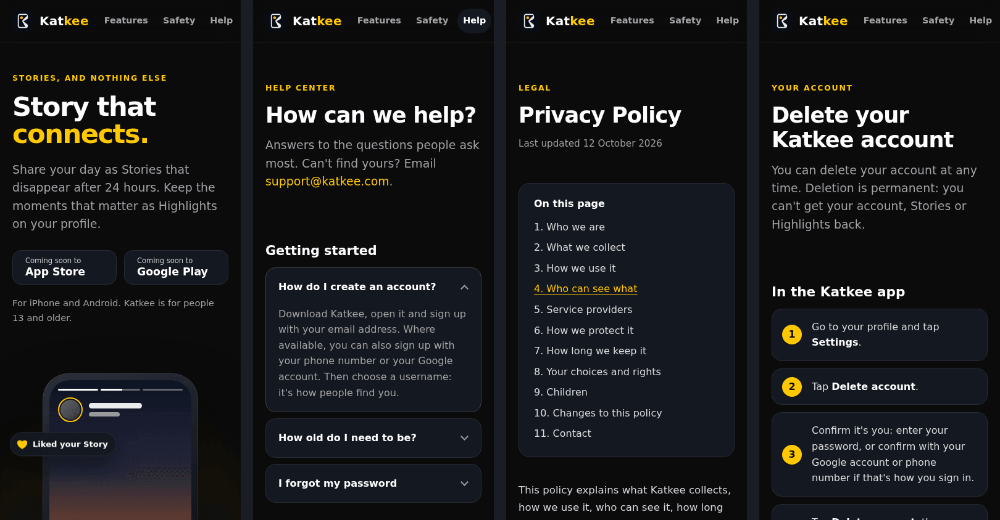

# Phase 13: release identity, icons and the katkee.com website

Date: 12 October 2026. Branch `claude/katkee-production-audit-kuexra`.
Labels follow `docs/BASELINE_REPORT_2026-10-05.md`.

**Production-ready: no.** Everything the app needs to know about its identity is now set and
checked: the domain, the API address, the bundle ID and the icon. The pages the stores require
exist and the API serves them. What is still missing can't be done from here: deploying to
katkee.com, building the native apps (no Mac; Android blocked by the network policy) and testing
on phones.

You supplied the app icon and the domain **katkee.com**, and asked for live Privacy, Terms and
Support pages, the production API address, a confirmed bundle ID and the icon, ready for the web,
the App Store and Google Play.

## What you asked for, and where it stands

| Item | Now | Status |
|---|---|---|
| Privacy Policy, Terms and Support pages | https://katkee.com/privacy, /terms and /support, plus a landing page (https://katkee.com) and an account deletion page (/delete-account, which Google Play asks for) | IMPLEMENTED AND VERIFIED: served by the API (11 server tests), rendered in Chromium at desktop and phone widths. **Live: BLOCKED** until you deploy; `npm run check:live` fails all 8 checks today because nothing is deployed |
| Production API address | `https://api.katkee.com/` in `mobile/build-config.json` | IMPLEMENTED AND VERIFIED (release check). **Live: BLOCKED** (not deployed) |
| Bundle ID, confirmed | `com.katkee.app` for iOS and Android (the iOS test target is `com.katkee.app.tests`); `releaseIdentifiersConfirmed: true` | IMPLEMENTED AND VERIFIED: `npm run check:ios-release` passes. Android's check waits only on your private upload key |
| App icon | Every size for both platforms, made from your PNG | IMPLEMENTED AND VERIFIED (sizes, formats, references, tracing accuracy) / NOT VERIFIED on devices |

*Generated from your artwork; the Android masks and themed icon are previews of what launchers
draw. Rendered here, not on a device.*

## What changed

### The icon on every surface (`scripts/brand-assets.cjs`)

One command makes everything from your PNG, kept as the master in
`brand/katkee-app-icon-1024.png`:

- **The mark is traced into vector paths** (marching squares at 50% coverage, sub-pixel), and the
  tracing is compared with your pixels before anything is written: a mean difference of **0.125
  levels out of 255**, and 0.0043% of values off by more than 64 (edge anti-aliasing). The dot is
  an exact circle (radius 71.1 px).
- **iOS**: the 1024 x 1024 App Store icon, opaque RGB as App Store Connect requires. A new
  **launch screen** replaces React Native's white template that said "Powered by React Native":
  your mark centred on the app's background. The status bar is light from launch.
- **Android**:
  - adaptive icon (Android 8+), with the mark sitting exactly as on the iPhone icon, inside every
    launcher shape's safe zone;
  - themed icon (Android 13+);
  - rounded and round bitmaps for Android 7;
  - a new status-bar notification icon (it replaces the provisional "K");
  - Android 12+ launch screen with your mark on the app's background;
  - a dark window from the first frame, so no white flash at launch or when the keyboard opens.
- **The app**: a `BrandMark` component draws the mark above the wordmark on the sign-in screen,
  and in About.
- **Google Play**: the 512 x 512 icon (32-bit, as Play asks) and the 1024 x 500 feature graphic.
- **Website**: favicon, Apple touch icon, header logo and the link-preview card.

*The app's real screen code, rendered with React Native for Web (`tools/screen-preview`). Not a
device screenshot. Google and phone sign-in are left out of the preview because they need native
SDKs.*

### The identity

- `mobile/build-config.json`: `https://api.katkee.com/`, `com.katkee.app` for both platforms,
  confirmed, and the three page addresses at katkee.com.
- Xcode (`project.pbxproj`) and Gradle (`build.gradle`) carry the same identifiers.
- About now shows the real release version (`build-config.json` through `appEnv`) instead of a
  hard-coded "1.0.0". Help links to the Help Center.

### The website (`website/`)

- **Pages**: the landing page, the Help Center, the Privacy Policy, the Terms of Service, account
  deletion, and a 404 page. Dark, in the app's palette and system fonts, with your icon. The
  landing page shows Katkee as it is: an illustration of the Story viewer (no fake people or
  numbers), the gestures, the six tabs, and safety. The App Store and Google Play buttons say
  "Coming soon" until you add the store links.
- **One source**: the Privacy Policy and Terms are the Markdown in `legal/`, which is now the
  publishable text. The drafting notes moved to `legal/README.md`, with what a lawyer should
  review. Contacts are filled in: support@, privacy@ and grievance@katkee.com.
- **The build refuses** broken links, unknown contact addresses, inline scripts or styles,
  unfilled placeholders and Markdown it can't render faithfully. The committed `website/public/`
  must match its sources, which `verify.cjs` checks.
- **Every claim matches the app.** Checking the copy against the code corrected three draft
  lines before they shipped: the Story viewer has no reply bar and no Follow button, so the
  illustration shows its real action rail and the feature list doesn't claim them.

The full desktop landing page: [assets/phase13-website-home.png](assets/phase13-website-home.png).

### Serving it (`backend/src/modules/website`)

- **The API serves the website**, so one deploy publishes the API, the Admin console and
  katkee.com. The files are read once into memory, compressed (brotli or gzip), revalidated with
  ETags, and content-hashed assets are cached for a year.
- **Headers**: a Content-Security-Policy that allows no scripts and nothing from other sites, no
  framing, `nosniff`, and HSTS in production.
- **With `WEBSITE_HOST=katkee.com`**:
  - katkee.com serves only the website: the API and the Admin console answer the site's 404 page
    there, writes get 405, and the realtime socket is refused before any sign-in check;
  - www.katkee.com redirects to katkee.com (a day's cache, never off the host, even for an
    absolute-form request);
  - the pages asked for on api.katkee.com redirect to katkee.com, so each page has one address.
- **Startup refuses** a `WEBSITE_HOST` that isn't a host name, or without the built website.
- **The cross-user access sweep** (release gate 26) covers the new asset route: a path that
  climbs out of the website gets the 404 page, never a file.
- **Deploying**: the Docker image copies `website/public` (a new `website` build context); the
  AWS stack takes `websiteDomainName` and an optional `websiteCertificateArn`, and outputs where
  to point DNS. The single-server route (Caddy) takes `WEBSITE_DOMAIN`.

### Store readiness fixes found on the way

- **Location is approximate only, on both platforms.** The location sticker asked Android for
  *precise* location, although it only shows a rounded, approximate place and the Privacy Policy
  says Katkee never accesses precise location. It now asks for approximate location, and the
  manifest no longer declares precise location. iOS already asked with reduced accuracy.
- **No storage permission.** A file library added a shared-storage write permission that Katkee
  never uses (its files stay in its own storage). The manifest now removes it, so Play's review
  and the Data safety form see only what Katkee needs.
- A new source check enforces both.

### Release and live checks

- `npm run check:ios-release` now also requires the App Store icon to be 1024 x 1024 and opaque,
  and every bundle ID in the Xcode project to belong to the app (no stray development ID).
- `npm run check:live` (new), for after a deploy: the API's health (database up) and readiness;
  the Privacy Policy, Terms, Help Center, account deletion and landing pages, each with its
  security headers and the right heading; and the www redirect. Run it before each store
  submission.

### Guides

- **`LAUNCH.md`** (new): the whole launch in order: mailboxes and DNS for katkee.com, the AWS
  deploy, the live check, then the two stores.
- **`docs/GOOGLE_PLAY_DEPLOYMENT.md`** (new): the upload key, the release bundle, testing, every
  Play Console form with Data safety answers matched to the policy, the listing text, the
  testing tracks (including the 12-tester rule for new personal accounts) and the release.
- `docs/IOS_APP_STORE_DEPLOYMENT.md`: updated for katkee.com and everything now done.
- `website/README.md`, `legal/README.md` (new), `BRAND.md` (rewritten: it claimed the app used
  the logo's colours, which wasn't true), `STORE_LISTING.md` (rewritten as a current checklist),
  `infra/README.md`, `README.md` and `RELEASE_READINESS.md`.

## Decisions to confirm

1. **The amber.** Your icon's dot is `#FCB020`; the app's accent (the locked palette) is
   `#FFC800`, a little lighter and yellower. Each keeps its approved value: the icon and launch
   screens use the artwork, and the app, the in-app logo and the website use the app's accent.
   To unify them, change one (`BRAND.md`, "Colours").
2. **Governing law: India**, where the service is hosted and phone sign-in is offered first.
   Change it in the Terms if your company is elsewhere. India's IT Rules also need the
   **Grievance Officer's name** on the pages (`legal/README.md`).
3. **The website is served by the API.** One deploy and one certificate; the website then
   carries the API's uptime. `website/public/` also works on any static host, if you'd rather
   publish the pages before the backend (`website/README.md`).
4. **The location sticker** now asks for approximate location on Android, as everything else
   does. The place it shows was already rounded to about a kilometre.

## Deliberate breaks: each check must fail on a real defect

**44 of 44 caught on the first run** (`mutations.json` in the evidence folder).
- **Server** (20): a weaker CSP; framing allowed; HSTS outside production; ETags ignored or weak
  ETags refused; assets not immutable; no compression; an unknown asset answered 200; the host
  compared case-sensitively or with its port; www not redirected, or redirected over http; the
  API reachable on the website's host; writes allowed there; the realtime socket open there; no
  redirect from the API host; an absolute-form target followed; a file outside the website served
  as an asset; `WEBSITE_HOST` not validated; the built site not required.
- **App** (9): the mark's colours swapped, its hole filled, or read by screen readers; no mark on
  sign-in; About's version a constant; About or Help opening the wrong page; a failed link
  silent; the terms notice's links swapped.
- **Checks, scripts and infrastructure** (15):
  - the release check accepting an icon with transparency, or a stray bundle ID;
  - the live check accepting a missing CSP, a www copy instead of a redirect, or a database
    that is down;
  - the website build allowing broken links, unknown addresses or scripts;
  - a white launch screen, or the Android 12 launch screen falling back to the default;
  - precise location declared, or requested by the sticker; the storage permission kept;
  - the stack forgetting `WEBSITE_HOST` or the website's certificate.

## Commands and results

Evidence: `docs/test-runs/2026-10-12T17-57-14-807Z/`.

| Command | Result |
|---|---|
| `node scripts/verify.cjs --bundle` | **All 10 steps passed.** Backend build; app typecheck and test typecheck; app component tests **16 suites, 84 tests**; source checks **142**; ranking **28**; infrastructure build and **39** tests; Android and iOS release JavaScript bundles |
| `scripts/run-tests.cjs` as the `postgres` user (real PostgreSQL 16) | **430 / 430** tests in 44 files; 0 failed, 0 skipped. Log: `database-integration.log` |
| Deliberate breaks | **44 of 44 caught** |
| `npm run check:ios-release` | Passes |
| `npm run check:android-release` | Only the 4 private upload-key settings missing (they must never be in the repository) |
| `npm run check:live` | **0 of 8**: nothing is deployed, and this environment can't reach the internet. Run it after deploying |
| `node scripts/brand-assets.cjs` | Tracing within 0.125 levels of the master; output deterministic (a second run changed no file) |
| Browser render (Chromium, Playwright) | Website: 6 pages at 1366 and 390 wide, no horizontal overflow, no CSP violations. App: sign-in and About |

Since Phase 12:
- **Backend tests**: 418 to 430 (the website, and the access sweep for its asset route).
- **App component tests**: 78 to 84 (the brand tests).
- **Source checks**: 123 to 142 (brand assets, website, live check, release check, permissions).
- **Infrastructure tests**: 38 to 39.

## Release gate changes (from the Phase 12 report)

| # | Gate | Was | Now |
|---|---|---|---|
| 3 | iOS archive | BLOCKED (no Mac); release check listed the owner's items | BLOCKED (no Mac); **the release check passes**: identifiers, API, pages, icon and privacy manifest are all set |
| 29 | Privacy policy, Terms, deletion process | PARTIAL: pages to be written and published | PARTIAL: **pages written, built, served and tested**; account deletion page for Google Play. Still needed: a lawyer's review, the Grievance Officer's name, and the deploy |
| 30 | Store metadata and screenshots | PARTIAL | PARTIAL: **icon, feature graphic, descriptions and both privacy forms' answers done**; screenshots need device builds |

Every other gate is unchanged from Phase 12.
